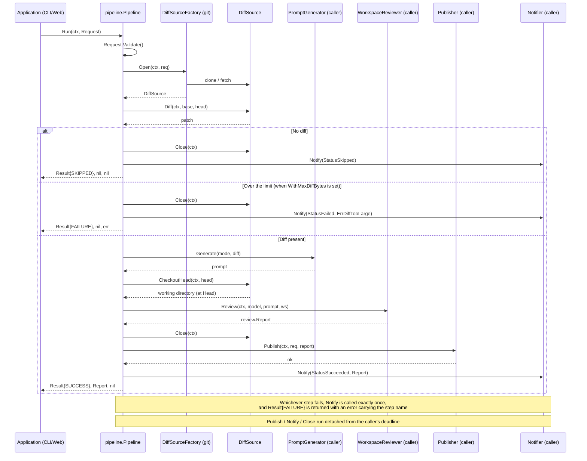

# 🤖 Go Review Kit

[](https://github.com/shouni/go-review-kit/actions/workflows/ci.yml)
[](#)
[](https://go.dev/)
[](https://go.dev/)
[](https://github.com/shouni/go-review-kit/tags)
[](https://opensource.org/licenses/MIT)
[](https://pkg.go.dev/github.com/shouni/go-review-kit)

English | [日本語](README.ja.md)

## 🚀 About - Take the diff, have an AI read it, store it, notify. No AI SDK included

**Go Review Kit** is a library that provides "take a Git diff → have an AI review it → store the
result → notify" as a single pipeline. It has no `main` package.

The review result is passed around as a typed `review.Report` (a verdict plus findings with
severities), and `ParseReport` takes care of interpreting and validating it. Since it does not
depend on any AI SDK, its use can change with the implementation — reviewing Markdown manuscripts,
for example, not only code.

### Out of scope

**The reviewer, the prompt wording, the storage target and the notification target are all the
caller's implementation.** Which AI SDK reviews (`review.WorkspaceReviewer`), what wording instructs
it (`review.PromptGenerator`), whether the result is kept as JSON or rendered to HTML and placed in
GCS / S3 / a DB (`review.Publisher`), and where it is announced (`review.Notifier`) are all
decisions that follow from how the display and operations are built. Giving the library defaults
for them would make every consumer carry rendering and dependencies it does not need. The only
direct dependency is `go-git`.

---

## ✨ Features

* **Refs are not limited to branches** — tags and commit hashes can be given directly. Resolution
  always goes "remote branch → commit", so a digits-only branch name (a ticket number, say) is
  never resolved as an abbreviated hash, which would take the diff of an unintended commit.
* **Three-dot comparison** — the merge base is the starting point, so commits that advanced on the
  base side do not mix into the diff.
* **Limits can be set from measurements** — `Result` carries the diff size, the duration, the
  model's usage and the number of tool calls. **It is filled even for failed runs.** The material
  for judging whether a limit is too strict lies with the runs that were rejected, not with the
  ones that passed.
* **The reviewer is agentic** — a `WorkspaceReviewer` can inspect the working directory with Head
  checked out by itself. Being able to look beyond the diff is a given, so a prompt saying "open the
  file and confirm it" or "cite what you checked as evidence" always holds.
* **Absorbs the noise the model mixes in** — even with structured output specified, the model may
  mix in Markdown fences, trailing remarks, backslashes it forgot to escape, and raw newlines.
  **The breakage happens after the response has been fully returned, so retrying the API call does
  not fix it.** `ParseReport` does nothing when the output parses as-is, and tries a repair only
  when it fails.

---

## 📦 Package Structure

| Category | Package | Role and responsibility |
| :--- | :--- | :--- |
| **Contract** | **`review`** | Defines the domain types, sentinel errors and every port. Depends on no other package |
| **Execution** | **`pipeline`** | Drives prepare → diff → prompt → Head checkout → AI → store → notify, and returns the result |
| **Implementation** | **`git`** | The concrete `review.DiffSource`: `GoGit` (pure Go, suited to throwaway environments) and `CLI` (uses the `git` binary, suited to environments that can reuse a checkout) |

The caller chooses which `git` implementation to use (this library does not choose). Details of
each type, port and option are on [pkg.go.dev](https://pkg.go.dev/github.com/shouni/go-review-kit).

---

## 🚦 Usage

Plug your implementations into `pipeline.Deps` and call `Run`.

```go
// reviewer / publisher / notifier / prompts are the caller's implementations.
func run(
	ctx context.Context,
	reviewer review.WorkspaceReviewer,
	publisher review.Publisher,
	notifier review.Notifier,
	prompts review.PromptGenerator,
) error {
	sources, err := git.NewGoGitFactory("/var/tmp/reviews", git.WithSSHKey("~/.ssh/id_ed25519"))
	if err != nil {
		return err
	}

	p, err := pipeline.New(pipeline.Deps{
		Sources:           sources,
		Prompts:           prompts,
		WorkspaceReviewer: reviewer,
		Publisher:         publisher,
		Notifier:          notifier,
	})
	if err != nil {
		return err
	}

	result, report, err := p.Run(ctx, review.Request{
		JobID:      "20260810-213000-a1b2c3d4", // optional; a correlation ID held by the caller
		RepoURL:    "ssh://git@github.com/shouni/example.git",
		Base:       "main",
		Head:       "develop",
		Mode:       "code", // any string; its meaning is decided by the PromptGenerator implementation
		Model:      modelName,
		StorageURI: "gs://bucket/reviews/20260810-213000-a1b2c3d4/report.json",
		PublicURL:  "https://example.com/history/20260810-213000-a1b2c3d4",
	})
	if err != nil {
		// The error carries the step name itself, so there is no separate field to match it with.
		// The kind can be told with errors.Is against review.ErrInvalidRequest / ErrRefNotFound /
		// ErrUnsupportedRepoURL / ErrDiffTooLarge.
		log.Printf("failed at %s: %v", review.StepOf(err), err)
		return err
	}

	// report is non-nil only when the review succeeded. With no diff it comes back nil.
	log.Printf("status=%s published=%v duration=%s",
		result.Status, result.Published(), result.Duration)
	return nil
}
```

**The guarantees a caller may rely on are written in the respective godoc, too** — that the
`Notifier` is called exactly once per `Run`; that the `Publisher` is called only on success and the
working directory is released before it; that a notification failure does not fail the pipeline;
that the limit on the review itself is set with `pipeline.WithRunTimeout`, not with `Run`'s
context; that no diff is not a failure while a diff that is too large is; that ignoring
`ParseInfo.Truncated` publishes a truncated review as a complete one; and that reviewing the same
repository concurrently needs `git.WithDirNamer`.

---

## 🔑 Repository URLs are SSH only

Authentication handles SSH keys only, so what is accepted is the scp form
(`git@github.com:owner/repo.git`), the `ssh://` scheme, and local paths (for development and
tests). **`http(s)` is refused as a form error** (the reason is in the godoc of
`git.GoGit.Prepare`).

---

## 🔄 Sequence Flow



---

## 📜 License

This project is released under the [MIT License](https://opensource.org/licenses/MIT).
